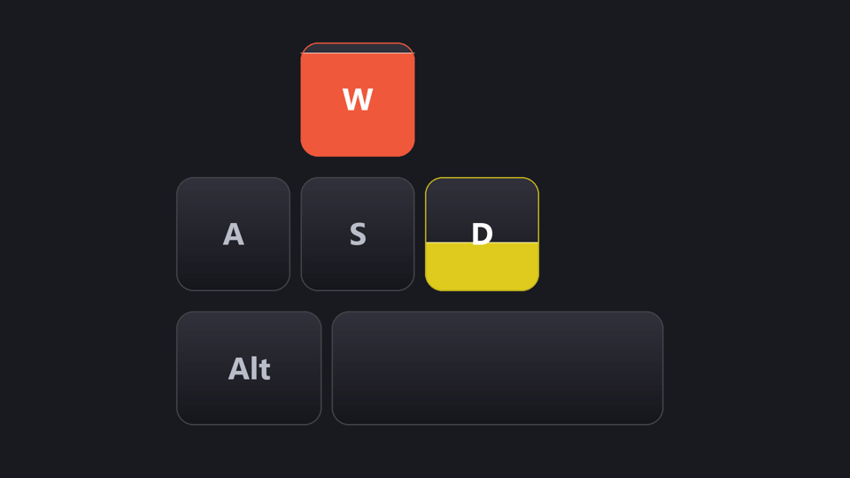

# Hall-effect key travel monitor (ROG Falchion ACE 75 HE)

Read the **real per-key travel depth** of a magnetic (Hall effect) keyboard —
0.00 to 3.50 mm in 0.01 mm steps at ~100 Hz — and turn it into measurements,
a live overlay, or a transparent video for video editing.



Windows · Python 3.8+ · no driver, no injection, no keyboard hook.

## What it does

| script | purpose |
|---|---|
| `hid-probe.py` | explore the vendor HID collection, dump descriptors, capture raw reports |
| `depth-probe.py` | CLI measurement: identify keys, actuation / reset point, rapid trigger, export CSV |
| `depth-live.py` | live monitor (local web UI + SSE), global hotkeys, auto-save, single-file exe |
| `depth-gui.py` | legacy Tk window (superseded by `depth-live.py`) |
| `kb-viz.py` | depth CSV -> interactive keyboard animation (HTML) |
| `kb-frames.py` | depth CSV -> transparent video (ProRes 4444 + alpha) or PNG sequence |
| `compose.py` | composite the overlay onto a gameplay recording |
| `test_pipeline.py` | headless regression tests (no keyboard needed) |

## Quick start

```bash
pip install pillow

# 1. see what the keyboard reports
python hid-probe.py listen

# 2. measure a key and export a CSV
python depth-probe.py measure --key W

# 3. live monitor (opens http://127.0.0.1:8765)
python depth-live.py

# 4. video for Premiere: PNG sequence (fastest) or ProRes 4444
python kb-frames.py recording.csv --alias Alt=LAlt --fps 60 --png-only
python kb-frames.py recording.csv --alias Alt=LAlt --fps 60

# 5. put it on the gameplay footage
python compose.py game.mp4 kb-frames-out.mov -o final.mp4 --offset 0
```

`depth-live.py` hotkeys (work while a game has focus, no window switching):

| hotkey | action |
|---|---|
| `Ctrl+Alt+R` | start / stop recording (saves on stop) |
| `Ctrl+Alt+S` | save the current recording |

Files land in `Documents\depth-recordings\` as `-long.csv` (event stream) and
`-wide.csv` (fixed 100 Hz matrix, one column per key).

## Data format

Long (one row per change):

```
t_s,wall,key,index,mm
0.000000,2026-11-25T20:15:52.487+08:00,A,31,0.31
```

Wide (100 Hz, one column per key, ready for spreadsheets / video):

```
t_s,wall,W,A,S,D
0.000,2026-11-26T21:14:48.485+08:00,0.00,3.50,0.00,0.00
```

## How it works

The keyboard exposes a vendor HID collection (usage page `0xFFC0`) with 21-byte
input reports. Byte 2 is the key matrix index, bytes 4–5 are the depth as
uint16 little endian in 0.01 mm. See [docs/PROTOCOL.md](docs/PROTOCOL.md) for the
full description, observed matrix indexes and the firmware quirks.

**Important limitation:** the firmware streams only one key at a time and zeroes
the previous key when you press another. To keep simultaneously-held keys in the
data, the monitor compares the reports against the OS key state and re-emits the
held keys (`Engine.run_hold`). Without that, a recording shows one key at a time
even though the live view shows several.

## Performance notes

`kb-frames.py` caches the static key art per worker and splits the frame range
across processes: ~200-280 fps at 1080p60 on 8 cores, versus ~22 fps for a naive
single-threaded loop. Encoding is the remaining bottleneck and is CPU only —
NVENC cannot encode an alpha channel (it silently falls back to `bgra`), so
ProRes 4444 / PNG stay on the CPU. A PNG sequence renders ~4x faster than ProRes
and Premiere imports it as an image sequence with alpha intact.

## Tests

```bash
python test_pipeline.py
```

Twenty-one headless checks, including the ones static reviews asked for:

* firmware switch-zero vs. real release (both orders)
* hold re-emission when the mapping table is empty
* mapping reset clearing `vk_held` / `press_state`
* rendered frames keep RGBA, and 1 worker produces byte-identical output to
  4 workers (spawn on Windows)
* a physical-key state captured under an old mapping cannot suppress a real
  release (mapping generation stamp)
* the press that teaches a new key keeps its own held state, while re-stamping
  one key does not resurrect the others
* a late refresh cannot resurrect a key that a reset already forgot
* a failing mapping save keeps the in-memory table usable
* ffmpeg refusing to start leaves no output file and no segment directory
* a missed key-up edge is repaired by the watchdog instead of leaving the key
  highlighted forever

## Licence

MIT — see [LICENSE](LICENSE).

## Disclaimer

Read-only measurement of your own hardware. It is not a cheat: no memory
access, no driver, no input injection. It does poll `GetAsyncKeyState`, which
some anti-cheat systems look at, so avoid running it alongside a competitive
game.
